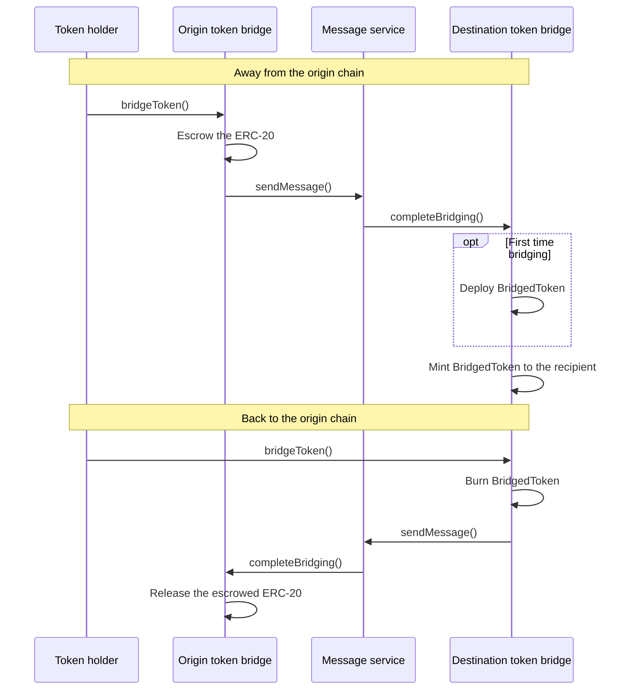

import GlossaryTerm from '@theme/GlossaryTerm';

The canonical token bridge is a pair of lock-and-mint contracts, one on the
<GlossaryTerm term="Lineth" /> network and one on its
<GlossaryTerm term="Finalization layer">finalization layer</GlossaryTerm>, that bridges any ERC-20 token.
It carries no cross-chain machinery of its own: every transfer is a message sent through the
[canonical message service](./canonical-message-service.mdx), and inherits that service's verification and
delivery model.

Native currency isn't bridged here.
It moves through the message service directly, as the value attached to a message.

## How it works

Bridging a token away from its origin chain involves locking and minting as follows:

1. The token holder calls `bridgeToken()` on the origin chain's token bridge.
    The bridge escrows the tokens and sends a message via the message service, instructing the bridge on
    the destination chain to complete the transfer.
2. When that message is claimed, the destination bridge mints an equivalent amount of a `BridgedToken`, an
    ERC-20 token it controls, to the recipient.
    The first time a given token is bridged, the destination bridge also deploys that contract,
    carrying over the escrowed token's name, symbol, and decimals.

Bridging back reverses this.
The holder calls `bridgeToken()` on the destination bridge.
That call burns the `BridgedToken` and sends a message releasing the escrowed tokens on the origin chain.
Because minted supply on one side is always matched by escrowed supply on the other, the bridge can't mint tokens
that were never locked.

The following diagram illustrates the round trip.

Operators can reserve token addresses so they can't be bridged, which is how tokens that need a dedicated bridge
are kept off the canonical one.
A token can only be reserved before it has been bridged.

## See also

- See the [bridge guide](../../../network/build/bridge.mdx) and
  [contracts](../../../network/build/contracts.mdx) for the workflow, ABIs, and addresses on Linea
  Mainnet, and the [Linea bridge](https://linea.build/hub/bridge/) for the public UI.
- See the [token bridge source code](https://github.com/LFDT-Lineth/lineth-monorepo/tree/main/contracts/src/bridging/token)
  in the `lineth-monorepo`.
